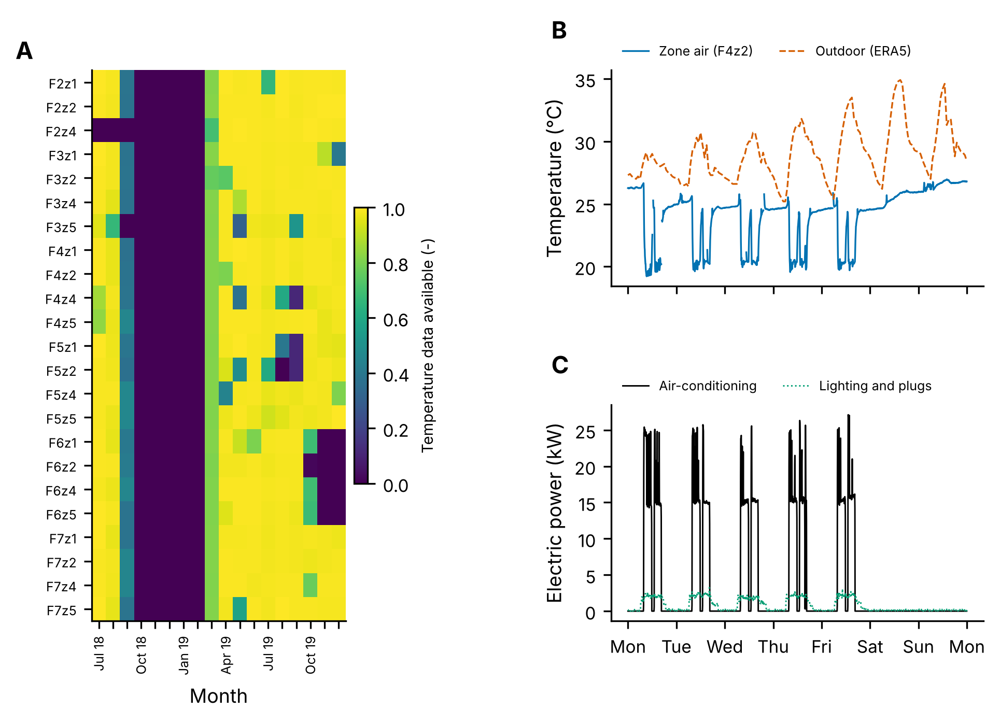
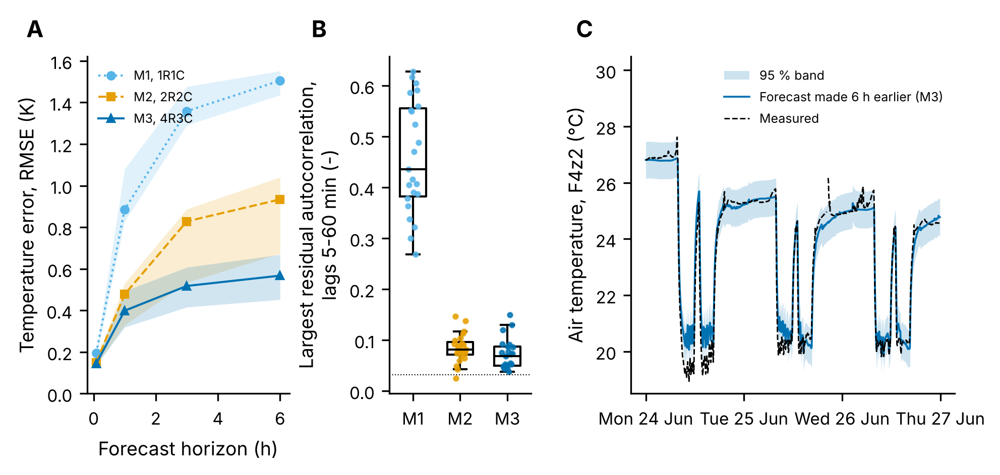
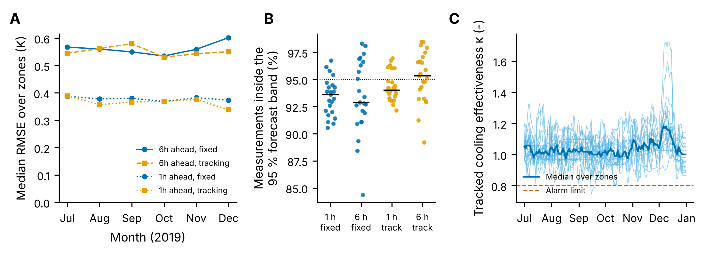
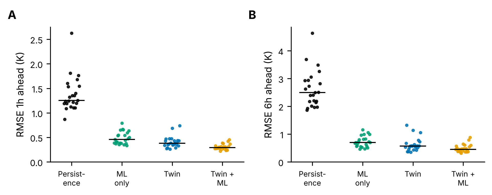
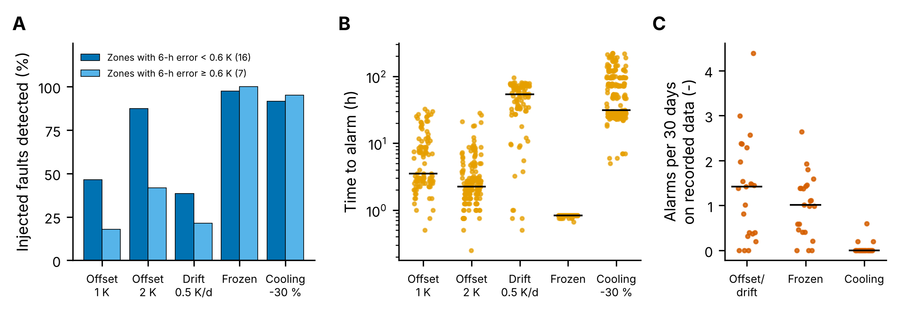
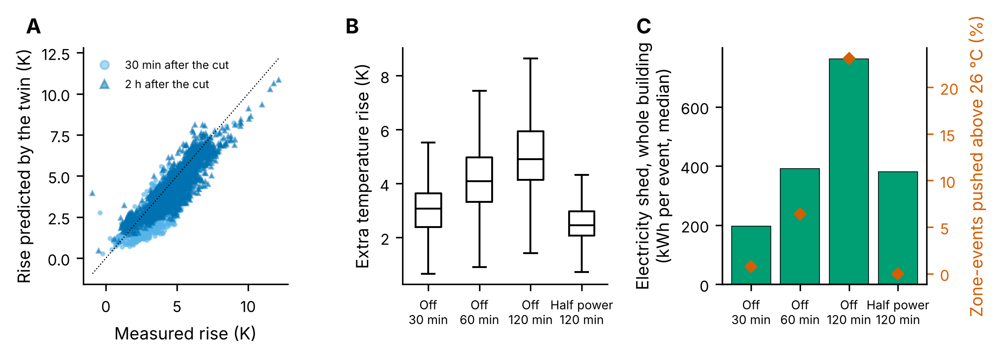

# A Digital Twin of a Real Office Building, Kept in Step by a Kalman Filter

A digital twin of the 23 air-conditioned zones of a seven-storey office building in Bangkok, built from 18 months of open measured data (CU-BEMS, 1-minute electricity and indoor sensors). For each zone, a grey-box thermal model is identified from the data, then run online as an extended Kalman filter. Each 5-minute step corrects the twin with the latest measurements, estimates the temperatures nobody measures (thermal mass, envelope), and tracks how well the air-conditioning cools. The synchronised twin is then used for what it is for: forecasting, fault diagnosis, and testing demand-response scenarios before trying them on the building.

| | Main result |
|---|---|
| Model detail | A 4R3C model (air, internal mass, envelope) cuts the 6-hour forecast error of a 2R2C model from 0.93 to 0.57 K (median) and leaves nearly uncorrelated residuals; selected in 22 of 23 zones |
| Operation | Fitted on two weeks of June, the twin forecasts the next six months at 0.56 K (6 h ahead), with no drift, and its 95 % bands hold 94-96 % of the measurements |
| Physics + ML | Learning the twin's own errors with gradient boosting cuts the 1-hour error from 0.38 K to 0.29 K; machine learning alone does worse than the twin (0.46 K) |
| Diagnosis | Frozen sensors found in 98 % of cases (median 50 min), a 30 % loss of cooling in 93 % (median 31 h); sensor offsets are found mainly in zones the model fits well |
| Flexibility | Checked on 2,300 real switch-off events (temperature rise predicted with an error below 0.8 K RMS over 2 h). Switching the whole building's units off for 30 min sheds about 200 kWh and pushes almost no zone above 26 °C, because the zones are kept at 20-21 °C |



*A: share of 5-minute temperature readings available per zone and month; the sensors were offline from October 2018 to February 2019. B, C: one week of zone F4z2 in June 2019. On working days the units start in the morning, cool the zone by about 5 K within half an hour and stop in the late afternoon; at weekends the zone floats.*

## Data

- **Building:** CU-BEMS, Chulalongkorn University, Bangkok: 1-minute power of every AC unit, lighting and plug circuit, and temperature, humidity and illuminance in each zone, July 2018 to December 2019 ([Pipattanasomporn et al., *Scientific Data* 7, 241, 2020](https://doi.org/10.1038/s41597-020-00582-3); figshare, CC BY 4.0). The 23 zones that have both air-conditioning and a temperature sensor are used. The files are downloaded, checked against their published MD5 sums and condensed to 5-minute means by a GitHub Actions job (`.github/workflows/fetch_data.yml`, `tools/prepare_data.py`).
- **Weather:** the dataset has none, so hourly ERA5 reanalysis at the building (temperature, global irradiance) is taken from the Open-Meteo archive (CC BY 4.0) and interpolated to 5 minutes. Its timing is checked against a clear-sky model of the site (best match within 10 min).
- **Cleaning** (`step1_data.py`, `results/data_quality.csv`): readings out of the physical range, sensors frozen for over 2 hours, and one-sample spikes are removed. The spike filter keeps steps: when a zone's units start, its temperature really does fall 5 K in 10 minutes, and a standard Hampel filter would have deleted those transients. Gaps in power up to 30 minutes are bridged; longer gaps split the record, and the twin restarts after them.

## Method

**Models at three levels of detail** (`twin/rc.py`). Each zone is a thermal network driven by outdoor temperature, solar irradiance, the measured AC power, the lighting and plug power, and a constant gain. M1 (1R1C) has the air node only, M2 (2R2C) adds an internal mass, M3 (4R3C) adds the envelope and a direct window path. The models are discretised exactly (zero-order hold) and identified by maximum likelihood, computed from Kalman-filter innovations so that missing readings are handled naturally (the prediction-error method of Bacher and Madsen, *Energy and Buildings*, 2011).

One subtlety: temperatures alone cannot give the absolute size of the heat flows. Scaling all capacities, gains and the cooling by the same factor leaves the temperatures unchanged, which the tests check. The apparent COP of the units is therefore fixed at 3, and the other heat-flow parameters are relative to it; time constants, forecasts and temperatures do not depend on that choice.

**The online twin** (`twin/twin.py`). An extended Kalman filter on the model state plus two hidden parameters: the cooling effectiveness κ (1 when the units cool as identified, a slow random walk) and an extra heat gain Δq (occupants, open doors, neighbouring zones; mean-reverting so a disturbance fades in forecasts). Noise levels and the time constant of Δq are chosen by maximum likelihood on the training data. Forecasts propagate mean and covariance through planned inputs, giving uncertainty bands.

**Evaluation.** Every model is fitted on 3-16 June 2019 and tested on data it never saw: the next fortnight for model selection (step 2) and July to December 2019 for operation, diagnosis and flexibility (steps 3-6). Forecasts use the measured weather and AC power over the horizon, as planned inputs, which is how the twin is used for what-if questions; they are therefore conditional forecasts, not pure predictions of a schedule.

## Results

### Which level of detail?



*A: test-fortnight forecast error against horizon (median and interquartile range over the 23 zones). B: largest autocorrelation of the one-step residuals at lags 5-60 min; the dotted line is the 95 % significance level for white noise. C: zone F4z2, forecasts made 6 h earlier, with the 95 % band.*

The single-capacity model is clearly too simple: its residuals stay correlated (largest autocorrelation 0.44, against 0.07 for M3) and its 6-hour error is 1.5 K. The extra states pay off. M3 has a 6-hour error of 0.57 K (median), and the likelihood-ratio test rejects M2 in favour of M3 in every zone (p < 2·10⁻⁵). AIC prefers M3 everywhere and BIC in 22 of 23 zones. The identified time constants separate cleanly: about 6 minutes for the air, under an hour for the fast surfaces and furniture, and several days for the structure (median 86 h). Several parameters end on the bounds of their physical range. In 11 zones there is no direct window path, and in 11 the lighting and plug power add nothing beyond the constant gain. In 19 the measurement noise sits at its lower bound, the sensor resolution, since 5-minute averages are smooth. These are reported in `results/identification.csv` rather than hidden.

### Six months of operation



*A: median forecast error over zones by month, July-December 2019. B: share of measurements inside the twin's 95 % band, per zone. C: daily tracked cooling effectiveness κ, each zone (thin) and median.*

Two weeks of June data are enough. The fixed twin's 6-hour error stays between 0.54 and 0.60 K for six months, through the end of the rainy season and into the cool season, with no sign of drift. Tracking κ and Δq improves the forecasts only marginally (0.55 vs 0.56 K) but calibrates the uncertainty better: 95.7 % of measurements fall inside the 6-hour 95 % band, against 94.4 % for the fixed twin. κ stays between 0.8 and 1.3 for most zones and days. Its rise in December, when outdoor air is cooler, is consistent with air-conditioners working more efficiently in cooler weather, which the fixed model does not represent.

### Physics, machine learning, or both?



*Forecast error July-December 2019 for 23 zones (each dot a zone, bar the median). Persistence: the temperature now. ML only: gradient boosting with the same information as the twin. Twin + ML: the twin plus a gradient-boosting model of its own errors. Trained on April to mid-June.*

| Median RMSE (K) | 1 h ahead | 6 h ahead |
|---|---|---|
| Persistence | 1.25 | 2.49 |
| ML only | 0.46 | 0.70 |
| Twin | 0.38 | 0.57 |
| Twin + ML | **0.29** | **0.45** |

With two and a half months of training data, the physical model beats a direct machine-learning model. The best results come from letting the machine learn what the physics misses, mainly occupancy patterns by hour and weekday. The hybrid beats the twin in 20 of 23 zones at 1 hour and 18 of 23 at 6 hours. The twin stays the core, because only it can answer questions about operation it has not seen, such as the scenarios below.

### Fault diagnosis



*Faults injected into the real records of August-December 2019 at random weekday mornings (12 per fault and zone). A: share detected within the window (2 days for offsets, 4 days for drift, 6 h for frozen sensors, 10 days for loss of cooling), split by how well the twin forecasts the zone. B: time from onset to alarm. C: alarms on the recorded data, which may contain real faults.*

Three detectors (`twin/diagnosis.py`):
- **Frozen readings** (the sensor repeats a value for an hour): 98 % detected, median delay 50 min.
- **Loss of cooling** (κ averaged over a day of operation below 0.8): 93 % of 30 % capacity losses detected, median 31 h, with almost no false alarms.
- **Sensor offset and drift**, from a CUSUM on 3-hour-ahead residuals of the twin with fixed parameters. One-step innovations cannot be used: the filter follows a biased sensor within a few steps, and a tracking twin would absorb the offset as an extra gain. A 2 K offset is caught in 74 % of cases (median 2.3 h), a 1 K offset in 38 %, a 0.5 K/day drift in 33 %. This depends strongly on how good the zone's model is. In the 16 zones whose 6-hour error is below 0.6 K, 88 % of 2 K offsets are found, against 42 % elsewhere (Spearman ρ = -0.64 between detection rate and forecast error). With one sensor per zone, an offset is only visible against a model that is tighter than the offset.

### Flexibility



*A: 2,305 real events where a zone's AC power dropped by over 80 % for at least 2 h (mostly the end of the working day); temperature rise predicted by the twin, synchronised up to the cut, against the measured rise. B: demand-response scenarios on 132 weekdays at 14:00, extra temperature rise relative to normal operation. C: electricity shed by the whole building per event (median), and the share of zone-events pushed above 26 °C with over 50 % probability that would otherwise have stayed below.*

Before using the twin for what-if questions, it is checked on the building's own natural experiments. Every time the units are switched off, the twin predicts the temperature rise from the state it had just before. The measured rise averages 3.3 K after 30 min and 4.7 K after 2 h. The twin predicts 2.8 and 4.3 K: it underestimates the first half-hour by about 15 %, and its 95 % band is too narrow at first (62 % coverage at 30 min, 88 % at 2 h). The comfort results below are therefore slightly optimistic.

The scenarios then ask what a demand-response event at 14:00 would cost in comfort. The zones are kept cold: 99 % of zone-days start below 24 °C, with a median of 20.5 °C. That leaves room:

| Scenario (all zones) | Electricity shed | Extra rise (median) | Zone-events pushed above 26 °C |
|---|---|---|---|
| Off 30 min | ~200 kWh | 3.1 K | 1 % |
| Off 60 min | ~390 kWh | 4.1 K | 6 % |
| Off 120 min | ~760 kWh | 4.9 K | 23 % |
| Half power 120 min | ~380 kWh | 2.5 K | 0 % |

Running at half power for two hours sheds as much as switching off for one hour, without pushing any zone above 26 °C. The rebound when the units restart is not modelled.

### Running cost

On a 2-core cloud machine, one 5-minute update of the most detailed twin takes about 50 µs and a 6-hour forecast about 2 ms. The state is under 1 kB and the Python heap under 10 kB per zone, so a whole building fits easily on a small embedded computer (`tools/benchmark.py`, `results/benchmark.json`; not tested on such hardware).

## Running it

```bash
pip install -r requirements.txt
python step1_data.py            # data quality and checks (1 min)
python step2_identify.py        # identification, 23 zones x 3 models (about 1 h on 2 cores, resumable)
python step3_twin.py            # six months of operation (about 10 min)
python step4_hybrid.py          # physics vs ML vs hybrid (about 12 min)
python step5_diagnosis.py       # injected faults (about 35 min)
python step6_flexibility.py     # switch-off validation and scenarios (2 min)
python make_figures.py
python tools/benchmark.py
python -m pytest tests          # 14 unit tests (30 s)
sphinx-build docs docs/_build   # API documentation
```

The condensed data are in `data/`. To rebuild them from figshare, run the `fetch data` workflow from the Actions tab, or `python tools/download.py raw && python tools/prepare_data.py raw data`.

## Tests

`tests/test_twin.py` checks the pieces against known answers:
- exact discretisation against a fine Euler integration;
- the scale invariance that motivates fixing the COP;
- recovery of known parameters and of the right model order from synthetic data with a sensor gap;
- white, unit-variance innovations from a correctly specified filter;
- equality of the twin and the plain Kalman filter when nothing is tracked;
- tracking of a 30 % loss of cooling;
- growing forecast uncertainty;
- the CUSUM, frozen-sensor and spike rules.

## Limitations

- **One temperature sensor per zone, zones independent.** Heat exchanged between neighbouring zones ends up in the constant and extra gains.
- **Weather.** ERA5 reanalysis rather than an on-site station, and the forecasts use the actual weather (a perfect weather forecast).
- **Air-conditioning as a measured input.** The thermostats are not modelled, so the scenarios fix the AC power and ignore the rebound afterwards.
- **Faults are injected, not observed.** False-alarm counts on the recorded data are upper bounds, because the records may contain real faults.
- **Season.** Models fitted in June are not retrained. April and May, when the building was run differently, are left out of the diagnosis tuning.

## Files

```
twin/data.py           loading, cleaning, weather, zone tables
twin/rc.py             M1-M3 grey-box models, discretisation, maximum-likelihood identification
twin/kalman.py         Kalman filter with missing data, RTS smoother, extended Kalman filter
twin/twin.py           the online twin (state + cooling effectiveness + extra gain), forecasts
twin/diagnosis.py      CUSUM, frozen-sensor and cooling detectors
twin/forecast.py       forecast evaluation helpers
twin/runner.py         running the twin over long records
step1-6_*.py           the study; results in results/
tools/                 data download and preparation, benchmark
tests/                 unit tests
docs/                  Sphinx documentation (Read the Docs configuration in .readthedocs.yaml)
```

Data: CU-BEMS (CC BY 4.0), ERA5 via Open-Meteo (CC BY 4.0). Code: MIT licence.
